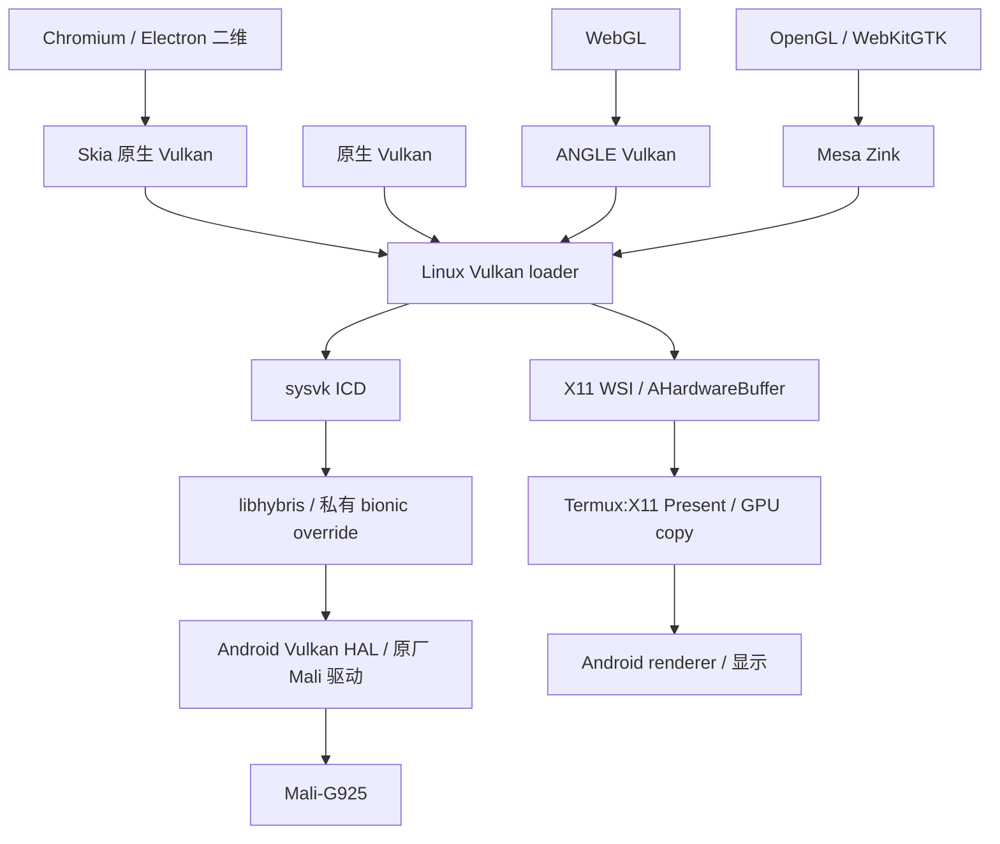
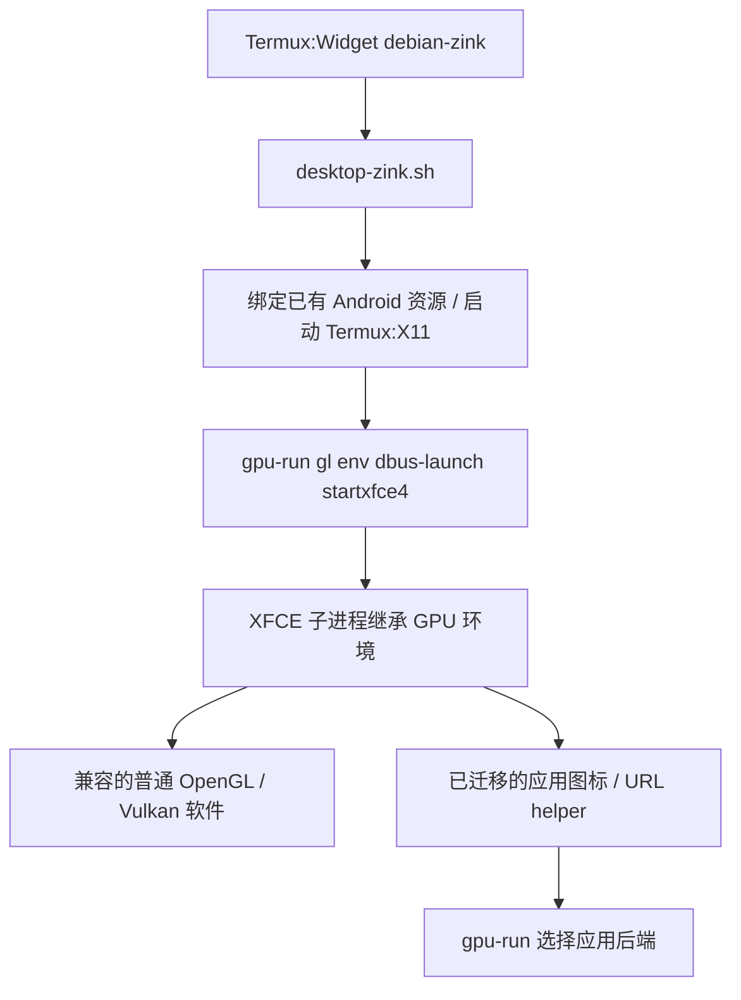

# 架构与组件

当前唯一基线和重启状态见 [CURRENT-STATE](CURRENT-STATE.md)。

## 两条数据路径

Linux 应用运行于 glibc，Android 厂商驱动依赖 bionic。`sysvk` 向 Linux Vulkan loader 提供 ICD 入口，`libhybris` 负责 Android 动态库与 ABI 兼容；驱动使用当前固件已有的 Mali 内核接口。

应用渲染和最终呈现需分别验证。WSI 的 AHB/socket/DRI3 专用协议连接 Linux 应用与 Termux:X11；Android 原厂 Vulkan 驱动本身不提供此处的标准 Linux X11 swapchain。

WebKitGTK 的 GPU 内容合成另有共享内存帧传输步骤。此路径能使用 Mali 渲染，但包含读回/传输成本，不能用 Vulkan/AHB 共享内存的性质推导整条路径零拷贝。

## 一个前缀包含完整桥接

构建默认前缀为 `/opt/pad7spro-gpu`；作者当前验收前缀为 `/opt/pad7spro-gpu-observe-20261012`。以下 `PREFIX` 代表所选独立前缀：

| 路径 | 职责 |
|---|---|
| `PREFIX/lib/libsysvk.so` | Vulkan ICD 与 Android HAL 初始化 |
| `PREFIX/lib/libhybris-common.so.1`、`lib/libhybris/linker/q.so` | Android 动态装载/兼容 |
| `PREFIX/lib/libahb-wrapper.so.1` | 通过 libhybris 解析公开 AHB API |
| `PREFIX/android-override/libc.so` | 固定来源和哈希的私有 bionic 运行时 |
| `PREFIX/share/vulkan/icd.d/sysvk_icd.json` | 当前前缀 ICD 描述 |
| `PREFIX/share/vulkan/implicit_layer.d/` | X11 WSI 库与 manifest |
| `PREFIX/lib/libwebkit-gpu-policy.so` | 显式 WebKitGTK 4.1 路由的策略适配 |
| `PREFIX/bin/gpu-run`、`gpu-launcher`、`trae-start` | 通用启动、可选菜单工具和 Trae 启动容错 |
| `PREFIX/bin/probe-*` | 核心与呈现的定向验证 |

库的 RUNPATH 和 manifest 固定到构建时的前缀。不能把已构建目录任意改名后继续使用。入口根据自身真实位置推导前缀，`PAD_GPU_PREFIX` 可显式指定；启动时核对文件、manifest 和组件是否越出所选目录。

`/opt/mali-bridge` 与 canary 是保留的旧基线。新的日常入口不再把两套目录混在同一进程中；旧 `gpu-app.sh` 只是转发到统一入口的兼容脚本。

## 默认环境与应用路由

`gpu-run` 不是必须手动打开的界面。会话启动时，它设置统一的驱动环境；原有应用图标再按需调用它选择后端。菜单中的 GPU 应用启动器只提供临时程序输入框。

Chromium/Electron 的二维 Skia 使用原生 Vulkan，WebGL 使用 ANGLE Vulkan；普通 GL/Vulkan 主要依靠会话继承。CC Switch 需要额外纠正应用主动禁用 GPU 的策略。纯 CPU 绘制和业务计算不会自动迁移到 GPU。

## 颜色、同步和帧率

当前 Termux:X11 使用 Xorg BGRA 字节契约，而 Mali 能导出的 AHB 是 RGBA。WSI 保留公共 BGRA 图像的真实格式，另分配私有 RGBA AHB，通过同队列 GPU copy 保留 BGRA 字节；现用 X11 再按既有契约显示。把这一步改成普通颜色转换 blit，会重复交换通道。sRGB 表面暂不宣称支持。

每张图像的 producer semaphore、传输指令与 fence 属于同一次同步提交；转换完成后才向 X11 Present。资源重建、线程取消和旧 swapchain 退役需保持图像/事件锁顺序与生命周期。详细修正在 [实现说明](implementation.md)。

`PAD_GPU_MAX_FPS=60` 在每个 WSI swapchain 呈现端以可取消等待限制提交，避免忙等。它不限制所有离屏 GPU 指令，也不比较静止内容。`X11_MAX_FPS=60` 是启动请求；原 APK 主要限制 RandR 报告值，第二阶段原生 tick 门控已在当前新 X server 加载的安装包中。配置上限不等于屏幕实际呈现帧率。

## Android 运行依赖

- 绑定 Android **已有**的 `/dev/binderfs`，不能在 chroot 新建一个无 Android 服务的实例。`binder_logs` 只是本机辅助识别条件。
- 需要正确共享 `/dev`、X11 socket，并绑定 `/system`、`/vendor`、`/apex`；root 身份不代替挂载命名空间和 SELinux 权限检查。
- 私有 bionic override 通过 `HYBRIS_LD_LIBRARY_PATH` 选择，不修改 Android 系统 libc。
- 保留 Present 的可见区域裁剪：screen pixmap 排除上层窗口，redirected pixmap 保留完整内容。XFWM 合成器当前关闭。

此项目不是新的 Mali 内核驱动，也不意味着厂商驱动已开源或可再分发。兼容范围取决于固件、Android 库、真实 Vulkan 特性和 Termux:X11 协议版本。
